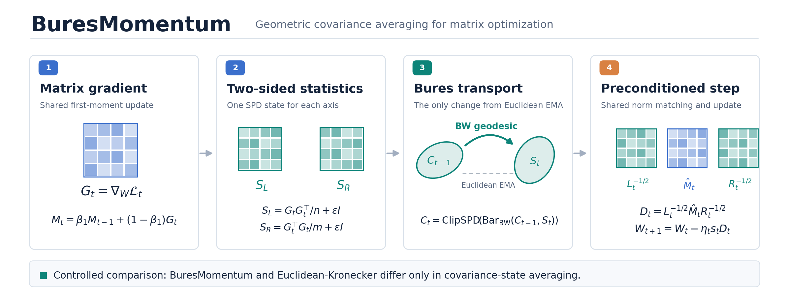

<div align="center">

# BuresMomentum

### Bures–Wasserstein covariance averaging for matrix preconditioning

[](https://github.com/Hik289/manifold-momentum-optimization/actions/workflows/ci.yml)
[](https://www.python.org/)
[](https://pytorch.org/)
[](LICENSE)

[**Install**](#installation) · [**Quick start**](#quick-start) · [**Reproduce**](#reproducing-experiments) · [**Code map**](#repository-map)

</div>



BuresMomentum changes **how the left and right covariance states are averaged**. The matrix gradient, first moment, inverse-root preconditioning, norm matching, and parameter step are shared with a paired Euclidean–Kronecker optimizer. This isolates the effect of Bures–Wasserstein (BW) geometry.

For a matrix gradient $G_t$, the two statistics are

$$
S_{L,t}=G_tG_t^\top/n+\varepsilon I,\qquad
S_{R,t}=G_t^\top G_t/m+\varepsilon I.
$$

Each SPD state uses a two-point BW barycenter before spectral clipping. The resulting inverse square roots precondition the bias-corrected first moment:

$$
C_t=\operatorname{ClipSPD}\!\left(\operatorname{Bar}_{\mathrm{BW}}(C_{t-1},S_t)\right),\qquad
D_t=L_t^{-1/2}\widehat M_tR_t^{-1/2}.
$$

The optimizer also supports the matched Euclidean update through `covariance_rule="euclidean"`. That switch changes the covariance averaging rule while retaining the same implementation path and hyperparameters.

## Installation

Python 3.10+ and PyTorch 2.1+ are required. From the repository root:

```bash
python -m venv .venv
source .venv/bin/activate
python -m pip install --upgrade pip
python -m pip install -e .
```

For tabular, vision, language, plotting, and data-preparation experiments:

```bash
python -m pip install -e ".[experiments]"
```

Graph experiments additionally require PyTorch Geometric, installed for the chosen PyTorch/CUDA environment:

```bash
python -m pip install -e ".[graph]"
```

## Quick start

```python
import torch
from bures.optimizer import MatrixOptimizer

model = torch.nn.Linear(32, 8)
optimizer = MatrixOptimizer(
    model.parameters(), lr=3e-4,
    covariance_rule="bures",  # or "euclidean" for the paired baseline
)

optimizer.zero_grad(set_to_none=True)
loss = model(torch.randn(16, 32)).square().mean()
loss.backward()
optimizer.step()
```

A deterministic CPU example and the geometric invariant checks run without downloading datasets:

```bash
python examples/quickstart.py
python experiments/tests/test_numerical.py --out /tmp/bures-numerical.json
```

The numerical suite checks SPD symmetry/positivity, transport identities, geodesics, the covariance update, block behavior, cache consistency, and mixed precision.

## Reproducing experiments

Job manifests are versioned under `experiments/*/jobs*.json`. They specify the task, method, learning rate, seed, and budget. Runners write per-run JSON histories under `experiments/extension/results/`; the directory is ignored by Git. **No dataset, model checkpoint, remote-machine configuration, or run log is required to install the optimizer.**

### One declared architecture job

Prepare the small public Wine Quality files and run one declared CPU job:

```bash
python experiments/expansion/prepare_data.py --wine-only
python scripts/run_expansion_job.py \
  exp2_tabular_wine_red_mlp64_bures_0.0003 --device cpu
```

To make a paired comparison, run the `adamw` and `euclidean` IDs with the same task/model/rate suffix. The full job budget comes from the manifest; these commands are not a shortened demonstration.

For CIFAR-10, CIFAR-100, and Fashion-MNIST jobs, `torchvision` downloads data into `data/vision/` on first use. Graph jobs use PyTorch Geometric's Planetoid loader. Word-language jobs require the prepared WikiText files:

```bash
python experiments/expansion/prepare_data.py
```

The preparation code records source revisions and split hashes. See the runner and the job manifest before changing data splits or budgets.

### Additional experiment families

| Family | Entry point | Data and scope |
|:--|:--|:--|
| Core geometry | `experiments/tests/test_numerical.py` | Synthetic SPD matrices; no download |
| Graph, vision, tabular, language, SciML | `experiments/extension/run_task.py` | Declared jobs in `experiments/extension/` |
| Architecture expansion | `experiments/expansion/run_benchmark.py` | Declared jobs in `experiments/expansion/jobs.json` |
| Fixed new-task study | `experiments/new_tasks/prepare.py`, then `experiments/new_tasks/dispatch.py` | Six declared tasks; full tuning and seed grid |
| Recovery and ablations | `experiments/recovery/`, `experiments/stage2/` | Matched controls and numerical diagnostics |
| Synthetic covariance geometry | `data/synthetic/` | Deterministic generators and ground truth |

The code retains failed and incomplete runs in the recorded histories. Validation data select hyperparameters and checkpoints; test data are evaluated only after selection. A single favorable configuration should be read as descriptive evidence, not as a task-family significance result.

## Repository map

```text
experiments/bures/       Optimizer and BW/SPD geometry primitives
experiments/tests/       Numerical and protocol checks
experiments/pipeline/    Shared optimizer interface and diagnostics
experiments/stage1/      Initial task-family runners
experiments/stage2/      Mechanism and ablation experiments
experiments/extension/   Long-budget task runners and result builders
experiments/expansion/   Architecture expansion and plotting
experiments/new_tasks/   Fixed six-task prospective study
experiments/recovery/    Failure-recovery controls
data/synthetic/           Synthetic SPD processes and ground truth
examples/                 Minimal runnable example
scripts/                  Single-job convenience entry point
assets/                   README diagram and its rendering source
```

The manuscript-layout utilities in `experiments/extension/` and `experiments/expansion/` operate on a separate LaTeX project and are included for completeness. The public code package does not bundle raw datasets, generated result histories, checkpoints, or the in-progress manuscript.

## Development

```bash
python -m pip install -e ".[test]"
python experiments/tests/test_numerical.py --out /tmp/bures-numerical.json
python examples/quickstart.py
```

The GitHub Actions workflow runs these CPU checks on every push and pull request. To redraw the README figure after editing the method diagram:

```bash
python -m pip install matplotlib
python assets/draw_intuition.py
```

## License

Code is released under the [MIT License](LICENSE). Dataset licenses remain with their respective sources.
