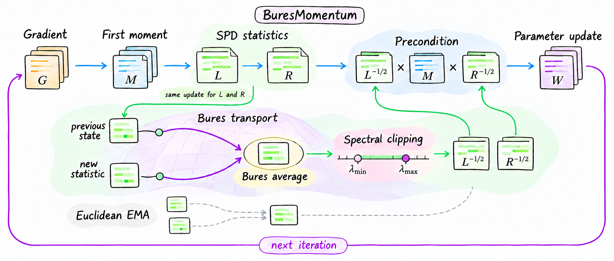

<h1 align="center">BuresMomentum</h1>
<p align="center"><strong>A matrix optimizer with Bures–Wasserstein covariance updates</strong></p>

<p align="center">
  <a href="pyproject.toml"></a>
  <a href="LICENSE"></a>
</p>

<p align="center">
  
</p>

## Method

BuresMomentum keeps two running covariance matrices for each matrix weight: one for its rows and one for its columns. It combines each old state with the latest gradient statistic using a Bures–Wasserstein (BW) average. This average accounts for changes in both the size and the direction of the covariance:

$$
C_t=\mathrm{ClipSPD}\!\left(\mathrm{Bar}_{\mathrm{BW}}(C_{t-1},S_t;\,1-\beta_2)\right).
$$

Here $C$ is either the row or column state, $S_t$ is its new gradient statistic, and $1-\beta_2$ sets the weight of the new statistic. `ClipSPD` limits the matrix's eigenvalues so it stays stable and invertible.

The optimizer uses the two updated states to rescale its running average of gradients (momentum) before changing the weight. It bounds how much the direction can be rescaled. For a direct comparison, set `covariance_rule="euclidean"`: this changes only the covariance average. Both versions use the same momentum, clipping, rescaling, and weight update.

## Installation

Install the core package with Python 3.10 or newer and PyTorch 2.1 or newer:

```bash
python -m venv .venv
source .venv/bin/activate
python -m pip install --upgrade pip
python -m pip install -e .
```

To run the included experiments, install their extra dependencies:

```bash
python -m pip install -e ".[experiments]"
```

Graph experiments also need PyTorch Geometric. Install a build that matches your PyTorch and CUDA versions:

```bash
python -m pip install -e ".[graph]"
```

## Quick start

```python
import torch
from bures.optimizer import MatrixOptimizer

model = torch.nn.Linear(32, 8)
optimizer = MatrixOptimizer(
    model.parameters(), lr=3e-4,
    covariance_rule="bures",  # use "euclidean" to compare averaging rules
)

optimizer.zero_grad(set_to_none=True)
loss = model(torch.randn(16, 32)).square().mean()
loss.backward()
optimizer.step()
```

Run a small CPU example without downloading data:

```bash
python examples/quickstart.py
```

## Tests

Install the test dependency and run the numerical checks:

```bash
python -m pip install -e ".[test]"
python experiments/tests/test_numerical.py --out /tmp/bures-numerical.json
```

These checks cover positive-definite matrices, BW transport, covariance updates, split matrix blocks, saved inverse roots, and lower-precision arithmetic. GitHub Actions runs them and the CPU example on every push and pull request.

To redraw the [detailed method diagram](assets/fig_buresmomentum_update_detailed.png):

```bash
python -m pip install matplotlib
python assets/draw_method_update.py
```

## License

The code is under the [MIT License](LICENSE). Each dataset keeps its own license.
